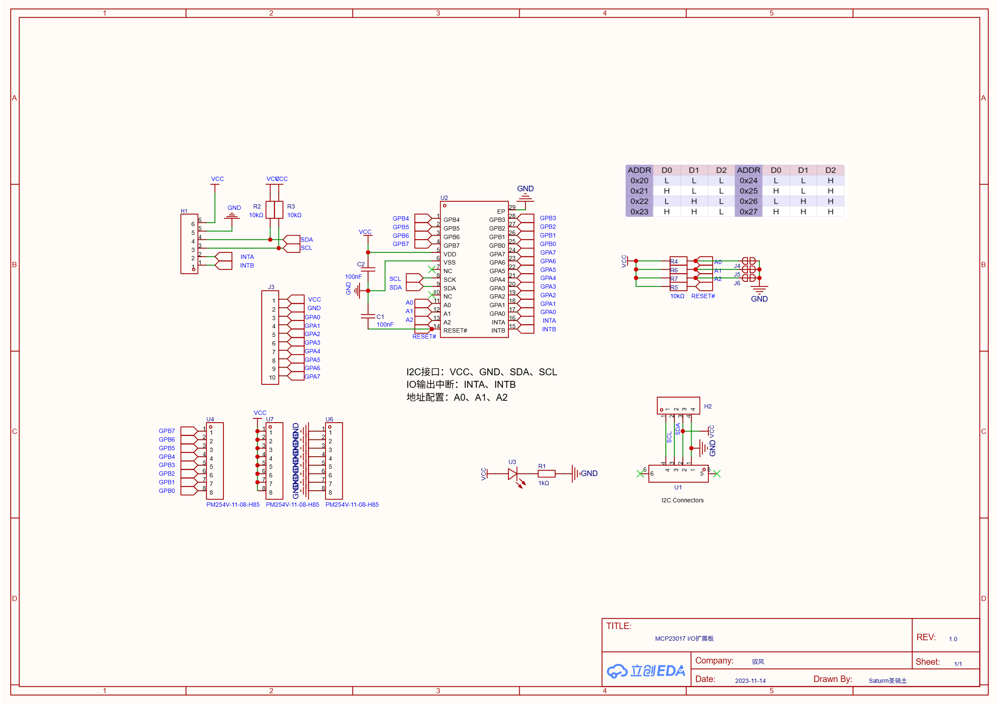
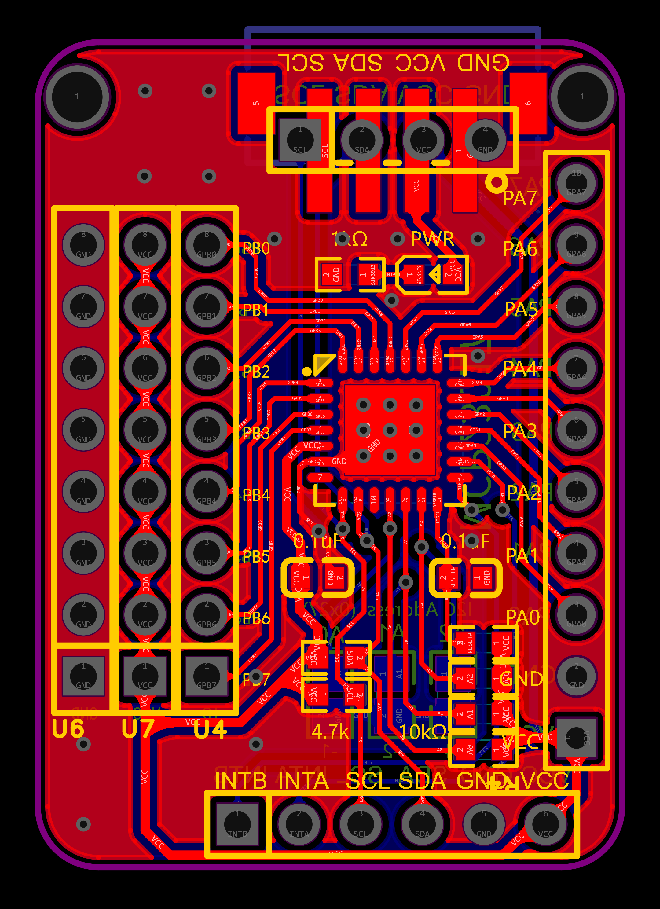
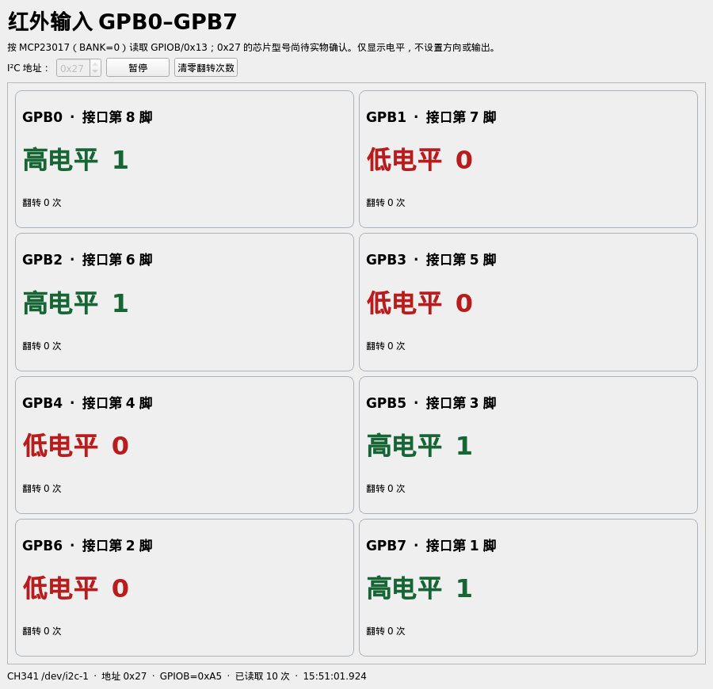

# MCP23017 I/O 扩展板

一块基于 MCP23017 的 I²C I/O 扩展板，适用于需要额外数字输入、输出的机器人项目。本仓库包含立创 EDA 专业版工程、原理图与 PCB 预览，以及树莓派上的输入验收程序。

## 连接方式

```text
树莓派或 Linux 电脑
        │ USB
        ▼
外置 USB 转 I²C 模块（例如 CH341）
        │ SDA / SCL / VCC / GND
        ▼
MCP23017 I/O 扩展板 → 传感器或其他数字 I/O 设备
```

CH341 是单独的转接模块，不在本扩展板的原理图中。接线时应共地，并确认扩展板供电和 I²C 信号电平与转接模块及外设匹配。请按原理图核对接口信号，不能仅根据接口外形把 I²C 接口当作标准 USB 使用。

MCP23017 提供 GPA0–GPA7 和 GPB0–GPB7 两组数字 I/O。I²C 地址由 A0、A1、A2 配置，范围为 `0x20`–`0x27`；实际使用的地址取决于硬件接线。

## 硬件资料

- [立创 EDA 专业版工程](hardware/MCP23017-IO-expansion-board.epro2)：包含原理图、PCB 及工程中的器件和封装数据。
- [原理图](docs/schematic.png)
- [PCB 布线图](docs/pcb-layout.png)





## 树莓派输入验收程序

[software/ch341_ir_gui.py](software/ch341_ir_gui.py) 使用 PyQt6 和 `smbus2`，读取 MCP23017 的 GPIOB 寄存器，显示 GPB0–GPB7 八路电平和变化次数。程序只读取端口，不设置引脚方向或输出；使用前请确认相应引脚已配置为输入。



程序使用 Linux I²C 设备接口，默认尝试自动查找 CH341 I²C 总线。需要事先安装兼容当前内核的 CH341 USB 转 I²C 驱动，并确保当前用户有访问 `/dev/i2c-*` 的权限。可参考 [Frank Zago 的 CH341 Linux 驱动项目](https://github.com/frank-zago/ch341-i2c-spi-gpio)；第三方驱动使用其原有许可，本仓库不包含驱动文件。

在 Raspberry Pi OS / Debian 环境下，可安装程序依赖：

```bash
sudo apt update
sudo apt install python3-pyqt6 python3-smbus2 i2c-tools
python3 software/ch341_ir_gui.py
```

默认 I²C 地址为 `0x27`，目标轮询周期为 20 ms。也可以指定实际地址和总线号，例如：

```bash
i2cdetect -l
python3 software/ch341_ir_gui.py --bus 1 --address 0x20 --interval-ms 50
```

上面的总线号和地址仅为示例，请以实际设备和硬件地址配置为准。需要图形桌面环境；程序当前**不支持 Windows 直接读取 CH341**，Windows 需要适配设备发现和 I²C 访问部分。

项目记录中曾在树莓派上读取一组 8 位端口。程序当前只覆盖 GPB，不代表 GPA、所有接线或完整机器人控制链路均已验证。

## 许可

- 本项目的软件代码和文字说明采用 [MIT License](LICENSE)。
- 作者拥有权利的硬件设计与原理图、PCB 预览图采用 [CERN-OHL-P-2.0](hardware/LICENSE-CERN-OHL-P-2.0.txt)。工程中可能包含的第三方器件库及其他第三方材料仍遵循其原有许可。
